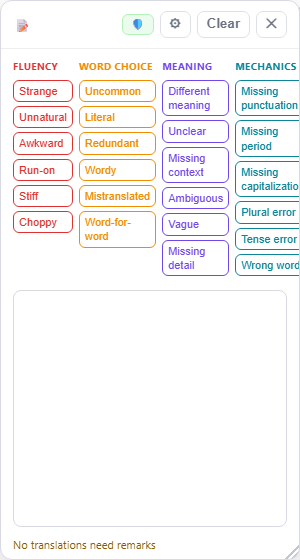
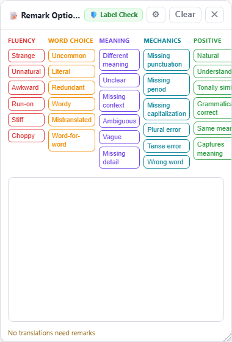
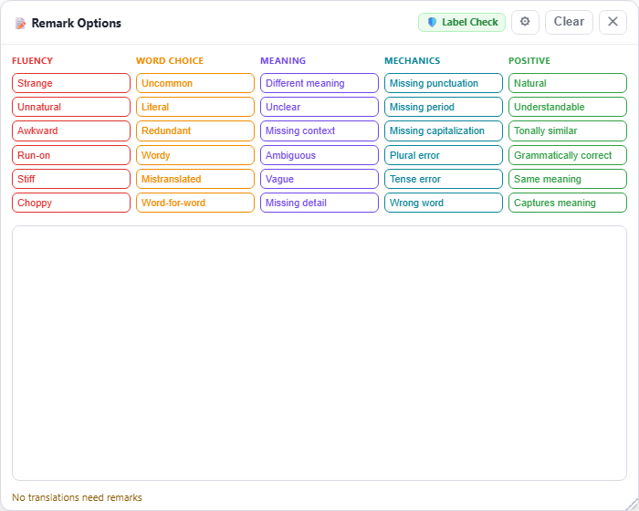

# v1.5.5 ledger

Branch `release/v1.5.5` (from `main` at `12837a9`). Final suite: **257 passed, 14 spec files** (`npx playwright test --reporter=list`). Baseline at the start: 199 passed. Not merged, tagged or pushed.

## Decisions applied (V1-V8)

| ID | Decision | Applied in |
|---|---|---|
| V1 | Header compacts badge-first: the badge label shrinks to its icon below 380px, then the title to the note icon below 340px. Breakpoints are set at 377/337 because the container query measures the content box inside a 1px border. | T5 |
| V2 | The Clear button keeps the word "Clear". | T5 (no change needed) |
| V3 | Extra window height goes entirely to the edit box; the chip palette keeps its natural height. | T5 |
| V4 | Settle delays centralised as `Utils.SETTLE_MS = { score: 200, remark: 250, qc: 220 }`, values unchanged. | T3 |
| V5 | `Q` on a selection that already ends the remark does nothing and shows the hint `Already quoted.` | T7 |
| V6 | A literal `"` inside a quoted selection is left as is (not escaped). | T7 (test only) |
| V7 | `.user.js` header keeps only the v1.5.5 and v1.5.4 notes plus `Full history: README.md -> Version history`. | T19 |
| V8 | The separator before any chip/phrase is always `", "`, even right after a quote. The colon and the `prevKind` detection are gone. | T8 |

## Per-task commits, tests and mutation checks

Suite size after each task is the figure its report or the orchestration ledger recorded.

| Task | Commit | Suite | Mutation check |
|---|---|---|---|
| T1 perf baseline tests | `d94f5ce`, `4892a51` | 201 | Tests were written red first: QC idle = 9 batches, composer typing = 20 scheduled settles. |
| T2 stop QC idle loop (D1) | `3800e63` | n/a | `setSummary` made unconditional: idle test fails (9 batches, expected 0). Restored. |
| T3 shared `observeSettled`, own-write filter (D2, D8) | `dfcd60c`, `522552d` | 204 | Filter made a no-op: typing test back to 20 scheduled. Restored. Fix round added `shouldSkip` so QC's scraping/adopting guard works at both sites. |
| T4 `rowSig` / `modulesBySuffix` / `remarkTextarea` into Utils (D3, D7, D18) | `4631364` | 206 | `Utils.rowSig` returning '' fails 9 tests (qc-swap, remark-target-selection, submit-check, perf, new shared test). |
| T5 pinned header, extra height to the edit box | `6be4461`, `0ab2a3a`, `12dee2d` | 213 | Container query disabled: 3 new tests fail. Palette cap restored: fails the added `maxHeight` assertion. (`flex:none` alone is belt and braces and fails nothing.) |
| T6 label badges on menu change (D6) | `0906681` | 214 | rAF loop restored: 120 renders, test fails. |
| T7 Q twice is a no-op (D9) | `9378e53` | n/a | Guard replaced with `false && ...`: Q-twice test fails. |
| T8 comma-join (V8) | `a52cf2f` | 216 after T9 | Quote-then-colon branch reintroduced: renamed test fails (`": Strange"` vs `", Strange"`). |
| T9 `CFG.keyQuote` (D21) | `337f25d` | 216 | Pure rename, no new test by design. |
| T10 QC panel-fit (D12) | `4e8f0c1` | 218 | Both load-time clamps removed: first test fails. |
| T11 shared `pickCascaderItem` (D14) | `912ffcc` | 219 | `isLeaf` inverted: 19 failures (qc-shortcuts 3, scoring 15, shared 1). |
| T12 `ADJACENT_GAP_PX` note, QC `CFG`, drop `escapeHtml` wrapper (D15, D16, D20) | `cc81cbd` | 219 | Structural; no behaviour change. |
| T13 opt-in `npm run coverage` | `73f4fbf` | 219 | Ratchet verified: a 99.0 baseline makes it exit 1. Lines 92.5%. |
| T14 X, Esc, arrows in label pick; shortcuts OFF; wrong-value stop | `30b665a` | 238 after T16 | `if (!ok)` in `applyOne` made `if (false)`: wrong-value test fails. |
| T15 chip Settings panel | `3045e40` | 238 | `localStorage.setItem` in `saveChipConfig` commented out: 2 tests fail. |
| T16 QC click-to-flip, single-sub-label pick | `a33e1b9` | 238 | Badge-branch guard forced to return: click-to-flip test fails. |
| T17 copy-icon stripping, three panels' drag/resize, new baseline | `5860a68` | 242 | Remark Options `onDrop` emptied: its drag row fails. Coverage 98.1%. |
| T18 W/A/S/D as arrow aliases | `c67e43e` | 257 | `ARROW_ALIAS = {}` in all three modules: exactly the 12 new WASD tests fail. |
| T19 docs, version bump, checklist | this commit | 257 | n/a |

Plus the prerequisite commit `0ef8885` (carries the spec and plan onto the branch; documentation only).

## Window screenshots (Task 5)

Remark Options at three widths, 560px tall:

-  - `window-300.png`
-  - `window-380.png`
-  - `window-700.png`

At 380px the badge shows its icon only and the title already reads "Remark Optio..." (see the live checklist, step 10). The three buttons stay in the corner at every width.

## Before / after (performance)

| Measure | Before | After |
|---|---|---|
| QC idle mutation batches (5s window) | 9 | 0 |
| Settle schedules while typing 20 characters in Remark Options | 20 | 0 |
| Label-pick badge renders per second | about 61 | 5 or fewer (test bound; observed well under) |
| Total line coverage (`npm run coverage`) | 88.9% | 98.1% |
| Function coverage | 86.1% | 93.8% |

## Controller rulings

Every `Ruling:` line from the orchestration ledger, in plain words.

- **Setup, spec and plan carried onto the branch.** The spec and plans were written on another branch and the superpowers plan was never committed, so none were reachable here. They went in as a documentation-only commit (`0ef8885`) before Task 1. Cost if wrong: none.
- **Mutation-check log location.** The plan said to record mutation checks in this file, which did not exist until Task 19. They were kept in the orchestration ledger and per-task reports and compiled here at the end.
- **Task 4 witness tests.** The brief named the scoring and qc-navigation row-change tests as the mutation witnesses. With `rowSig` broken those stayed green while nine other row-change tests failed. Accepted as an adequate check; the brief had picked the wrong witnesses. A deferred minor asks for a source-text-only row-change test.
- **Task 5, `POPOVER_MIN_W`.** The implementer lowered the minimum window width from 300 to 220. Overruled and restored to 300: the spec says to raise it, the measured header fit (214px) was already under 300, and lowering it would be an unrequested behaviour change.
- **Task 5, header layout.** Accepted the implementer's variant (title shrinks, badge pushed right) over the brief's, because the brief's version broke the existing "badge hugs right" test and the real requirement (buttons pinned inside the window) is tested.
- **Task 5, substituted mutation checks.** Accepted: the container-query mutation fails the corner-offset test, and a `maxHeight === 'none'` assertion was added so the palette-cap mutation fails too.
- **Task 5, comment wording.** The controller's own `POPOVER_MIN_W` comment claimed 300 keeps the palette from scrolling horizontally. The 380px screenshot shows it already clips, so the comment was reworded in the fix round.
- **Tasks 7-9 batched.** Three small edits to the same area of `remark-composer.js` went to one implementer as three separate commits and one reviewer. Cost if wrong: a finding on one task could delay the other two.
- **Task 10, extra clamp.** Accepted an extra `clampIntoView` after QC's first scrape. The saved-position clamp runs before the panel fills in, so it measured a tiny panel that later grew off-screen.
- **Task 10, test viewport.** Accepted a 1280x1100 viewport for the on-screen test: the fixture's QC panel is about 875px tall with no maximum height and clamping position cannot fix height. Short viewports are not covered.
- **Task 10, width assertion.** Accepted asserting the panel's width is unchanged rather than empty, since the panel carries an inline width from its template.
- **Task 11, `pickCascaderItem` hook.** Before dispatch the controller required a hook so Scoring Shortcuts can re-read its "before" value after the category click; without it the commit would compare against a stale value and report "not applied".
- **Task 11, signature.** Accepted `Utils.pickCascaderItem(popup, index, opts)` with `beforeLeafClick` and `findPopup` options, wider than the brief's two arguments, because both modules need them to keep behaving as today.
- **Tasks 14-16 batched.** Three "add tests for existing behaviour" tasks went to one implementer as three commits; Task 17 stayed separate because it re-measures coverage.
- **Task 14, X during a label pick.** The plan's coverage table said X leaves label mode, but the code ignores X there. The test asserts today's behaviour and production is unchanged. See "Open questions for the owner".
- **Task 16, click-to-flip test.** Accepted a test that clicks the badge text. Disabling only the Adopt button's handler fails nothing because the badge branch handles the same click, so that is redundancy in production code, not a test gap.
- **Task 19, extra checklist steps.** The live checklist goes beyond the brief's seven steps (W/A/S/D, comma join, title truncation and QC panel height) because the plan's own Tasks 8 and 18 added those behaviours.
- **D11 (user-authorised).** Two stale agent worktrees and their branches, both fully contained in `main`, were removed with non-forced commands. The `release/v1.5.3`, `release/v1.5.4` and `spec/submit-check-remark-gate` branches were left alone.

## Deferred minors

Collected from the reviews; none blocks the release.

- T1: perf composer test's two sequential expects hide the second counter when the first fails.
- T3: `ownRootRemoved` in `utils.js` is effectively dead given the flat DOM; the Settings-typing test would pass either way.
- T4: no direct test of `modulesBySuffix` first-match-wins; unused `remarkTextarea` alias in the composer.
- T5: `updateCheckBadge` splits on the first space (all current texts have one); badge-title test is weak.
- T6: badge observer is scoped to the popup's container at start; the `@perf` test only checks an upper bound.
- T7: the overlap test does not catch a closing-side-only guard; T9: uppercase `CFG.keyQuote` would never match.
- T10: the post-scrape clamp runs unconditionally, converting QC's default centred layout to explicit left/top; it runs once per page start, not per row.
- T11: the unexpected-outcome branch commits (a bare `else`).
- T12: a comment above QC's `PATH_KEY` is slightly stale.
- T13: `package.json` `"capture"` lost a space; `coverage-run.js` exit code on a signal; only the `page` fixture is instrumented.
- T16/T14: a negative test uses a fixed 500ms wait; arrow-key label-pick tests use "badges gone" as the leave-mode proxy.
- T17: the clipboard test re-installs the sanitizer rather than using the boot-installed one.
- T18: `e.key.toLowerCase()` would throw on a keydown with no `key` (pre-existing further down); `ARROW_ALIAS` is defined three times.

## Left uncovered on purpose

Measured with `npm run coverage` after Task 17: 98.1% of lines, 93.8% of functions. What remains uncovered is deliberately left that way, because a test would need fault injection plus a real timeout wait and would only prove an error path stays quiet:

- `catch` blocks and `.catch(() => {})` callbacks that run only when NOVA's own dropdown fails, or never opens and times out:
  - QC Compare: `writeCascade`, `clearCascade`, `relabel`, `erase`.
  - Scoring Shortcuts: the `setScore` throw.
  - The `waitFor(...).catch(() => {})` timeout guard in `utils.js` (dropdown-close wait).
- The QC start-up 8s ready-timeout log.
- No branch was confirmed truly unreachable in Task 17, so nothing was deleted.

Small leftovers that are not failure paths and are not covered either (not required by the plan): the QC help-toggle click handler and the Scoring Shortcuts minimize button / restore pill.

## Open questions for the owner

- **X during a label pick.** Pressing X while a label menu is open is currently ignored (only digits and the up/down keys act in label mode). The original plan's coverage table assumed X would cancel the pick. The tests assert today's behaviour and production was not changed. Decide whether X should cancel the pick; if so it is a one-line change plus flipping one test.
- **Title truncation and QC panel height** (see live checklist step 10): is "Remark Optio..." at the default 380px width acceptable, and is the QC panel's bottom being cut off on a short screen worth a later fix?
- **D22** (`isLabelComplete` mid-level-category gap) remains out of scope and is still in the backlog.
